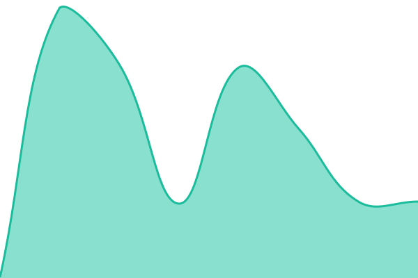

# LetMeDoIt Status

**Right now:** <!--live status--> **🟩 All systems operational**

**Live page:** https://letmedoit-org.github.io/status/ (will move to https://status.letmedoit.app once DNS is set up, see below)

## What this repository is

This is the public status page and uptime monitor for [LetMeDoIt](https://www.letmedoit.app): the mobile app services, the AI assistant, the web app, the provider dashboard, both websites and media delivery. It is built with [Upptime](https://upptime.js.org), so everything runs on GitHub:

- **GitHub Actions** check every service every 5 minutes (`.github/workflows/uptime.yml`).
- **GitHub Issues** are the incident records. A failed check opens an issue automatically and closes it when the service is back.
- **GitHub Pages** serves the public page from the `gh-pages` branch.
- `history/summary.json` is the machine-readable feed that the letmedoit.org `/status` page reads (plan Phase 2).

The page is written for our members and the people who support them: plain words, and never colour alone. The headline box at the top says in words whether everything is working (for example "All systems are operational"), and any open problem is listed under **Active incidents** with a short note from us. The card for each service shows its uptime and response time. Upptime's cards mark state with a coloured edge only, so the words live in the headline and the incident list; the letmedoit.org `/status` page (plan Phase 2) will show an icon **and** a word on every line.

Plan and decisions: `STATUS_PAGE_PLAN.md` in the LetMeDoIt monorepo (parent epic [letmedoit.org#95](https://github.com/LetMeDoit-org/letmedoit.org/issues/95), this phase [#1](https://github.com/LetMeDoit-org/status/issues/1)).

## What we check

| Line on the page            | What we ask                                                                | Healthy answer                           |
| --------------------------- | -------------------------------------------------------------------------- | ---------------------------------------- |
| Mobile app services         | `https://api.letmedoit.app/health`                                         | 200                                      |
| AI assistant                | `https://api.letmedoit.app/ping/chroma` (with the `X-Status-Probe` header) | 200                                      |
| Web app (web.letmedoit.app) | `https://web.letmedoit.app/`                                               | 200                                      |
| Provider dashboard          | `https://cms.letmedoit.app/login`                                          | 200                                      |
| Website letmedoit.app       | `https://www.letmedoit.app/`                                               | 200                                      |
| Website letmedoit.org       | `https://www.letmedoit.org/`                                               | 200                                      |
| Media delivery              | `https://files.letmedoit.app/`                                             | 404 with Azure's `ResourceNotFound` body |

The database and cache probes (`/ping/db`, `/ping/redis`) are deliberately **not** on the public page; Azure availability tests cover them and alert security@ (plan Phase 4). Any answer slower than 5 seconds counts as Degraded.

### How we check Media delivery

`files.letmedoit.app` serves member uploads from Azure Blob Storage through Azure Front Door. Every object on that host belongs to a member, so there is no file we can point a public monitor at without exposing it. Instead we request the host root: when DNS, Front Door and the storage account are all healthy, Azure answers `404` with a `ResourceNotFound` body, every time. If any link in that chain breaks, the answer is a 5xx, a Front Door error page, or no answer at all, and the check fails. If we ever add a small, permanent public object (for example `status/probe.txt`), point the check at it and change `expectedStatusCodes` to `[200]`.

## How incidents are posted

Automatic detection opens an issue in this repo. People can also open one by hand:

- **Something is broken now:** open an issue with the **Incident update** template (label `status`). It appears on the page while it is open.
- **Planned work:** open an issue with the **Planned maintenance** template (label `maintenance`) at least 24 hours ahead.

Who does what (short version of plan §6.1):

| Step                        | Who                                                                                                        | When                                 |
| --------------------------- | ---------------------------------------------------------------------------------------------------------- | ------------------------------------ |
| Detect                      | Automatic (Upptime here, Azure availability tests)                                                         | continuous                           |
| Declare + first public note | Whichever engineer sees it first (Krishna or Aravind). No approval needed; false alarms are simply closed. | within 15 minutes                    |
| Updates                     | Same engineer, or a hand-off noted on the issue                                                            | at least every 60 minutes while open |
| Resolve                     | Engineer who fixed it closes the issue (automatic ones close themselves)                                   | when checks are green                |
| Post-incident review        | One engineer writes, the other approves, as an Incident issue in the affected repo                         | within 2 business days               |
| Maintenance                 | One engineer plans, the other acknowledges                                                                 | at least 24 hours notice             |

Public wording rule: short, no jargon, say what the person can do. Example: "Sign-in may fail for a few minutes. Your information is safe. Try again after 10:30 am ET."

## Changing this repo

- `.upptimerc.yml` is the only configuration file. Change it through a pull request; `.github/CODEOWNERS` asks the other code owner for review.
- The Upptime bot commits generated data directly to `main` (`history/`, `api/`, `graphs/`, the status table below) and publishes the site to `gh-pages`.
- **`main` has no enforced branch protection today, so `CODEOWNERS` is advisory only: a direct push to `main` is not blocked.** How that came about (decision recorded on [#1](https://github.com/LetMeDoit-org/status/issues/1)): on 2026-10-19 this repo was removed from the organisation ruleset "SOC2 - Default branch protection" (ruleset 17127921, `repository_name.exclude: ["status"]`) because that ruleset requires a pull request for every change to the default branch, which would also block the bot's data commits above. The replacement is the repository ruleset **"SOC2 - main protection (status repo)"** on `refs/heads/main` (ruleset 25401045: pull request with 1 code-owner approval, signed commits, no force-push, no deletion). The organisation's `require-linked-ticket` check could not be attached: it lives in the internal `.github` repo and GitHub refuses to require an internal repo's workflow from a public repo's ruleset, so "Closes #N" in PR bodies stays a convention here. The ruleset is in **evaluate** mode: GitHub records every violation under Insights → Rule insights but blocks nothing. GitHub refuses to add the built-in GitHub Actions app as a bypass actor (`Actor GitHub Actions integration must be part of the ruleset source or owner organization`), so the ruleset can only be switched to **active** once the Upptime GitHub App (follow-up 3) is installed on the organisation and added as its bypass actor; switching it on before that would block the bot. Until then, config changes still go through pull requests by convention, and Rule insights is the audit trail that shows whether anyone bypassed that convention.
- **Tokens.** The workflows run on the default `GITHUB_TOKEN`. The enterprise policy fixes its default to read-only, so each workflow carries an explicit `permissions:` block (`contents`, `issues`, and `actions` for Setup CI). Upptime's `update-template` step regenerates the workflows without that block, so **Setup CI, Update Template CI and Updates CI are disabled** in the Actions tab. To update the Upptime template: run Update Template CI once by hand, then re-add the `permissions:` blocks in the same PR. The clean fix is a GitHub App (preferred by Upptime): create one with read/write on Actions, Contents, Issues and Workflows, install it on this repo, set the repository **variable** `GH_APP_ID` (the App's Client ID) and the **secret** `GH_APP_PRIVATE_KEY`, then re-enable the three workflows and drop the `permissions:` blocks.
- **Secrets.** `STATUS_PROBE_TOKEN` (repository secret, same value as the Key Vault secret `STATUS-PROBE-TOKEN` in `kv-letmedoit-staging` and `kv-letmedoit-production`) is sent as the `X-Status-Probe` header to the AI assistant probe. The API ignores the header today (`/ping/chroma` answers 200 without it); it becomes required when lmdi-backend [#427](https://github.com/LetMeDoit-org/lmdi-backend/issues/427) (PR [#429](https://github.com/LetMeDoit-org/lmdi-backend/pull/429)) ships, after which a wrong or missing header gets a 404. **Rotation rule: rotate the Key Vault secret and this repository secret together, and make sure both match before #429 is merged.** If the repository secret is missing or stale, uptime-monitor sends the literal text `$STATUS_PROBE_TOKEN` as the header value (it leaves an unresolved `$NAME` as is), the AI assistant line goes **Down** on the public page and a public incident issue opens. The same happens if the API is deployed without `STATUS_PROBE_TOKEN` set. Never commit the value or print it in a workflow. Upptime's strict `secrets:` allowlist is deliberately not set yet: when present it is the complete list, so add it together with the email notification secrets (follow-up 2), listing all of them, or they would be dropped from regenerated workflows.

## Follow-ups

1. **Custom domain `status.letmedoit.app`.** Owner action in Route 53 (`letmedoit.app` zone): `status.letmedoit.app CNAME letmedoit-org.github.io`. Then, in a PR, replace `baseUrl: /status` with `cname: status.letmedoit.app` in `.upptimerc.yml`, and set the custom domain in Settings → Pages (`gh api -X PUT repos/LetMeDoit-org/status/pages -f cname=status.letmedoit.app -F https_enforced=true` once the certificate is issued). Update the links above and in the plan.
2. **Email notifications to security@letmedoit.org (SMTP secrets).** Needs Mailgun SMTP credentials as repository secrets: `NOTIFICATION_EMAIL=true`, `NOTIFICATION_EMAIL_FROM`, `NOTIFICATION_EMAIL_TO=security@letmedoit.org`, `NOTIFICATION_EMAIL_SMTP=true`, `NOTIFICATION_EMAIL_SMTP_HOST`, `NOTIFICATION_EMAIL_SMTP_PORT`, `NOTIFICATION_EMAIL_SMTP_USERNAME`, `NOTIFICATION_EMAIL_SMTP_PASSWORD`. Until then, both engineers are assigned to every automatic issue and get GitHub's email for it.
3. **GitHub App token** instead of the `permissions:` blocks (see "Changing this repo"). Once the App is installed on the organisation: add it as a bypass actor on the repository ruleset (`gh api -X PUT repos/LetMeDoit-org/status/rulesets/25401045 --input ruleset.json` with `bypass_actors: [{actor_type: Integration, actor_id: <App id>, bypass_mode: always}]`), then set `enforcement: active`. That is the moment `CODEOWNERS` becomes enforced.
4. **Outage test** (acceptance in #1): temporarily point one site at a URL that answers 500 and confirm an issue opens, then closes.

## Status table (generated)

<!--start: status pages-->
<!-- This summary is generated by Upptime (https://github.com/upptime/upptime) -->
<!-- Do not edit this manually, your changes will be overwritten -->
<!-- prettier-ignore -->
| URL | Status | History | Response Time | Uptime |
| --- | ------ | ------- | ------------- | ------ |
|  [Mobile app services](https://api.letmedoit.app/health) | 🟩 Up | [mobile-app-services.yml](https://github.com/LetMeDoit-org/status/commits/HEAD/history/mobile-app-services.yml) | 

 193ms
     
 | 

<a href="https://status.letmedoit.app/history/mobile-app-services">100.00%</a>
    

|  [AI assistant](https://api.letmedoit.app/ping/chroma) | 🟩 Up | [ai-assistant.yml](https://github.com/LetMeDoit-org/status/commits/HEAD/history/ai-assistant.yml) | 

 114ms
     
 | 

<a href="https://status.letmedoit.app/history/ai-assistant">100.00%</a>
    

|  [Web app (web.letmedoit.app)](https://web.letmedoit.app/) | 🟩 Up | [web-app.yml](https://github.com/LetMeDoit-org/status/commits/HEAD/history/web-app.yml) | 

 204ms
     
 | 

<a href="https://status.letmedoit.app/history/web-app">100.00%</a>
    

|  [Provider dashboard](https://cms.letmedoit.app/login) | 🟩 Up | [provider-dashboard.yml](https://github.com/LetMeDoit-org/status/commits/HEAD/history/provider-dashboard.yml) | 

 264ms
     
 | 

<a href="https://status.letmedoit.app/history/provider-dashboard">100.00%</a>
    

|  [Website letmedoit.app](https://www.letmedoit.app/) | 🟩 Up | [website-letmedoit-app.yml](https://github.com/LetMeDoit-org/status/commits/HEAD/history/website-letmedoit-app.yml) | 

 133ms
     
 | 

<a href="https://status.letmedoit.app/history/website-letmedoit-app">100.00%</a>
    

|  [Website letmedoit.org](https://www.letmedoit.org/) | 🟩 Up | [website-letmedoit-org.yml](https://github.com/LetMeDoit-org/status/commits/HEAD/history/website-letmedoit-org.yml) | 

 312ms
     
 | 

<a href="https://status.letmedoit.app/history/website-letmedoit-org">100.00%</a>
    

|  [Media delivery](https://files.letmedoit.app/) | 🟩 Up | [media-delivery.yml](https://github.com/LetMeDoit-org/status/commits/HEAD/history/media-delivery.yml) | 

 207ms
     
 | 

<a href="https://status.letmedoit.app/history/media-delivery">100.00%</a>
    

<!--end: status pages-->

## License

- Powered by: [Upptime](https://github.com/upptime/upptime)
- Code: [MIT](./LICENSE)
- Data in `./history`: [Open Database License](https://opendatacommons.org/licenses/odbl/1-0/)
